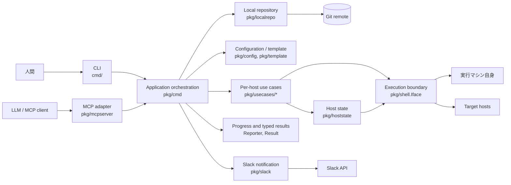
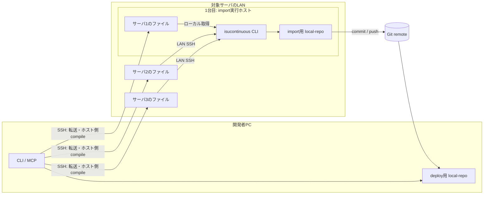
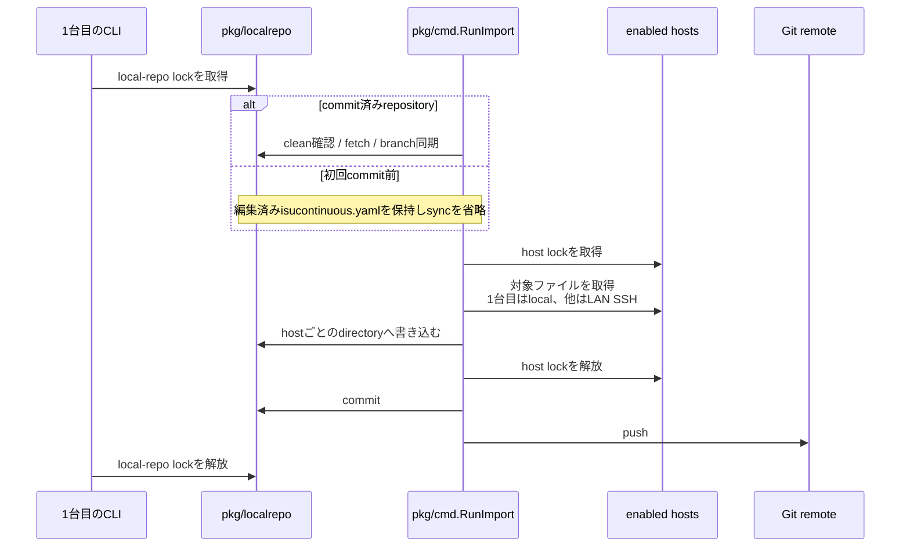
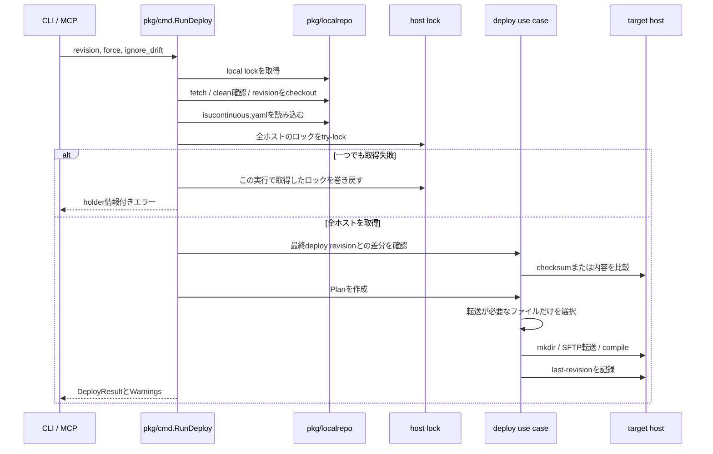
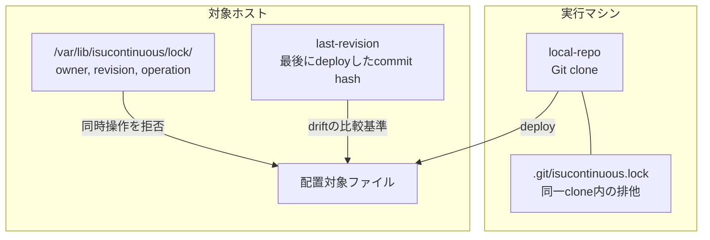

# Architecture

この文書は、isucontinuous の各機能を一通り使った開発者に向けて、内部の責務分割、主要な処理フロー、拡張ポイントと現在の制約を説明する。

## 全体像

isucontinuous には CLI と MCP という2つの入口がある。MCP は開発ループで安全に使う7操作だけを公開するが、公開された操作は CLI と同じ `pkg/cmd` のユースケース入口を呼び出し、型付きの結果を受け取る。対象ホストへの接続方法は `pkg/shell` に隠蔽し、その上に deploy、import、lock などのホスト単位の処理を構築している。

## レイヤーと責務

| 場所 | 主な責務 | 原則 |
|---|---|---|
| `cmd/` | Cobra のフラグ、環境変数、CLI表示 | 処理本体を持たない薄いアダプター |
| `pkg/mcpserver` | MCP tool schema、progress通知、構造化応答、成果物サイズ制限 | 公開対象に限りCLIと同じ `pkg/cmd.Run*` を呼ぶ |
| `pkg/cmd` | コマンド全体の順序制御、複数ホストの並列実行、ロック、警告、結果の組み立て | 外部表示を行わず、型付き結果を返す |
| `pkg/usecases/*` | deploy、import、install、profiling、afterbench、lock のホスト単位処理 | CLIやMCPを知らない |
| `pkg/localrepo` | isucontinuousが管理するcloneのGit操作とローカル排他 | 作業ツリーの整合性を守る |
| `pkg/config`, `pkg/template` | YAMLの読み込み、ホスト選択、環境変数・revisionの展開、事前検証 | 接続開始前に設定不備を検出する |
| `pkg/shell` | ローカル実行、SSH、SFTP、known_hosts | 実行先の差を `Iface` の背後に隠す |
| `pkg/hoststate` | 対象ホスト上のロックと最終deploy revision | 複数の実行マシンから共有できる状態を扱う |
| `pkg/slack` | Slack API呼び出しとfake実装 | 通知失敗をdeploy失敗へ昇格させるかは `pkg/cmd` が決める |
| `pkg/errors` | 呼び出し側が判別可能なエラー型 | 文字列だけで状態を判定しない |

### 入口を共有する仕組み

`pkg/cmd` の各操作は `ConfigXxx` を受け取り、`*XxxResult` と `error` を返す。CLIは結果を人間向けに表示し、MCPは同じ結果を構造化データとして返す。`init`と`import`は実行場所とrepository状態を人間が確認する必要があるためCLI専用である。同期とpushは独立コマンドではなく、`import`の内部フェーズとしてのみ実行する。MCPが公開するのは `setup`、`deploy`、`diff`、`status`、`profiling`、`afterbench`、`release` である。

ホストごとの進捗は `Reporter` インターフェースへ送る。

- CLI: `ProgressReporter` がプログレスバーを表示する。
- MCP: progress token がある場合だけprogress notificationを送る。
- テスト: `RecordingReporter` がイベントを記録する。

この境界により、処理本体が標準出力やMCP SDKへ直接依存することを避けている。

## 実行場所とデータフロー

通常の開発ループと、サーバ上のファイルをrepositoryへ取り込む処理では実行場所が異なる。

- **import**: 1台目のサーバでCLIとして実行する。1台目のファイルはローカルに取得し、他ホストのファイルはLAN内のSSHで取得する。全コンテンツを開発者PCまでWAN転送しない。
- **deploy以降の開発ループ**: 各開発者のPCでCLIまたはMCPを実行する。Git remoteからrevisionを取得し、変更ファイルを対象ホストへSSH/SFTPで送り、compileは対象ホスト上で実行する。
- 1台目の設定済み`host`と`os.Hostname()`が完全一致する場合は自動的にローカル実行となる。`local: true`でも明示できる。`name`は実行場所によって変わらない。

## import の処理フロー

`import` は追加取り込みで必要だった `sync` と `push` を内包し、local-repoのロックを全工程で一度だけ保持する。

取得に失敗した場合はpushせず、取得済みファイルを作業ツリーに残す。pushに失敗した場合はlocal commitを残す。原因を直し、ホストロックが残っていれば`release`したうえで`import`を再実行する。同じホスト内容の再取得では追加commitを作らず、残っているlocal commitをpushする。単独の`sync`と`push`コマンドは持たない。

import先のpathは各componentを`Lstat`で検査し、local-repo内のsymlinkを辿らない。host directory自体がsymlinkならremote read前にhost全体をskipし、下位のsymlinkなら影響するfile/subtreeだけをskipして警告する。一方deployはrepository内のsymlinkを辿る。この非対称性により、2、3台目の共通コンテンツを1台目のdirectoryへのsymlinkで配る従来運用を維持できる。

## deploy の処理フロー

deploy はファイル転送だけではなく、Git revision、ローカル作業ツリー、対象ホストのロック、driftを一つの処理として整合させる。

### Plan と Execute

`pkg/usecases/deploy` はdeployを2段階に分けている。

1. `Plan`: local-repoを走査し、symlinkを解決して、コピー元・コピー先・compileコマンドを確定する。
2. `Execute`: 対象ホストのchecksumと比較し、変更されたファイルだけを転送してcompileを実行する。

`diff` とdeploy前のdrift検査も同じ計画・比較処理を利用する。転送方式を追加する場合は、計画生成と実行を分離したまま拡張する。

## 状態と排他

isucontinuous は、実行マシン上の状態と対象ホスト上の状態を分けている。

- local-repoのロックは、同じcloneを複数プロセスが同時にcheckout・変更することを防ぐ。cloneを共有しない別PCの開発者は妨げない。
- ホストロックは対象ホスト上に置くため、別PCのCLIとMCPからの操作も排他できる。
- deployはロックを保持したまま終了し、profilingとafterbenchは同じ所有者・revisionであることを確認する。
- afterbench成功時、または明示的な`release`でホストロックを解放する。
- `/var/lib/isucontinuous`へ書けない場合は`/tmp/isucontinuous`を使用する。

## 設定の読み込み

`isucontinuous.yaml` は `pkg/config.Load` で一度だけ読み込む。そこで次を完了してからSSH接続を開始する。

1. `disabled`ホストの除外
2. `name`の補完と重複確認
3. 接続情報に含まれる環境変数の展開
4. `port`の解析
5. 展開後の`host`と実行マシンのhostnameの完全一致によるlocal判定
6. deploy、profiling、afterbenchのテンプレート構文検証
7. 平文passwordなどの警告生成

Git revisionを必要とするテンプレートは、deploy対象として解決したcommit hashを使って実行時に展開する。

## エラー、警告、部分結果

- ホスト上の失敗は `HostTask` でホスト名とタスク名を保持する。
- 複数ホスト処理では、一部完了後に失敗しても取得済みの結果を返す。
- 続行可能な問題は `Warnings` に積み、CLIは標準エラー、MCPは構造化応答で返す。
- Slackの認証・送信失敗は警告として扱い、deployやafterbenchの本処理は継続する。
- MCPのafterbench成果物は、サーバ上の元データを変更せず、応答へ載せる内容だけをサイズ制限する。

## 拡張ポイント

### 新しいコマンドを追加する

基本的な追加箇所は次のとおり。

1. `pkg/cmd` に入力設定、型付き結果、`RunXxx` とオーケストレーションを追加する。
2. ホスト単位の処理が独立している場合は `pkg/usecases/<name>` に置く。
3. `cmd/` にCLIアダプターを追加する。
4. LLMの開発ループから安全に呼ぶ必要がある操作なら、`pkg/mcpserver` に入力schemaとtool登録を追加する。repository操作を公開するだけの理由では追加しない。
5. 複数ホスト処理は `perHostExec` と `Reporter` を使い、警告と部分結果を失わないようにする。

CLIだけ、またはMCPだけに処理本体を置くと、公開範囲が重なる操作の振る舞いがずれるため避ける。

### 実行先を追加する

ホスト単位のユースケースは `shell.Iface` に依存する。ローカル実行とSSH実行はこのインターフェースの実装で切り替わる。新しい実行方式を追加する場合は、コマンド実行、ファイル転送、ファイル読み込みの意味を揃える必要がある。

### 表示方法を追加する

処理結果は型付きで、進捗は `Reporter` に分離されている。新しいUIやプロトコルは、`pkg/cmd`を変更せず、結果の変換とReporter実装として追加できる。

## 現在の拡張上の制約

拡張用の境界はあるが、完全なplugin architectureではない。

- CLIとMCPのコマンド定義は個別に登録しており、自動生成ではない。MCPにも公開するコマンドの追加時は両方の更新が必要になる。
- `RunXxx`はロガー、local-repo、接続クライアントを内部で組み立てる。内部の`runXxx`やconstructor functionはテストで差し替えられるが、外部向けDIコンテナはない。
- 対象ホストの操作はPOSIX shell、Git、SSH/SFTPを前提としている。
- known_hostsのパスはprocess globalな設定であり、同一プロセス内で異なる設定を並行利用する設計ではない。

設計判断の背景と制約は [`docs/adr/`](adr/README.md) を参照する。
